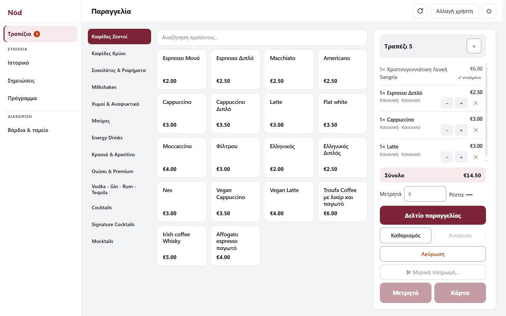
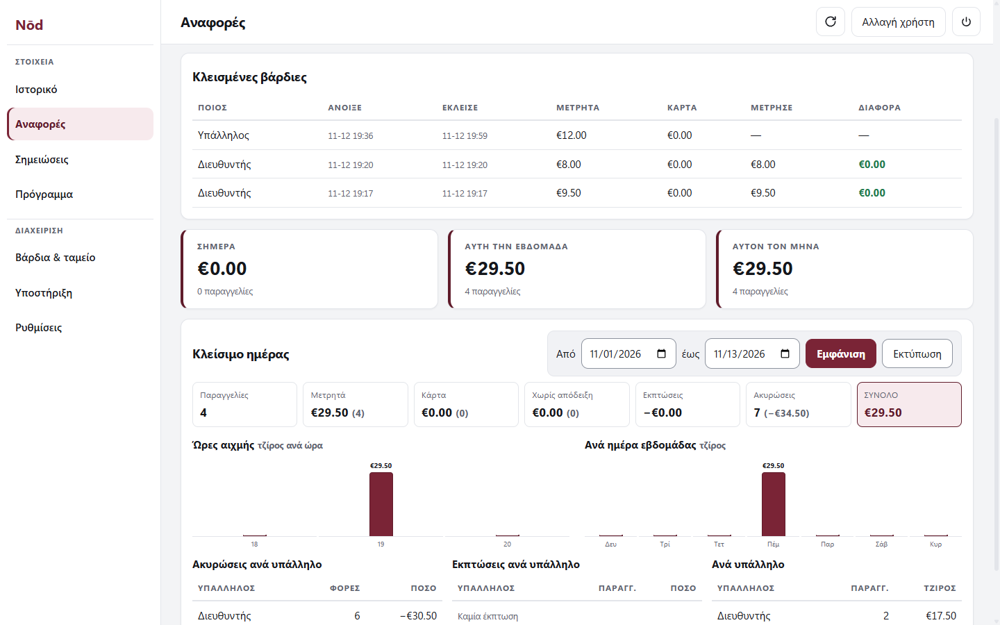
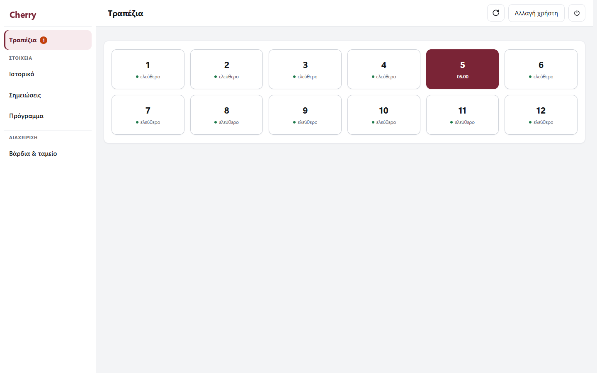
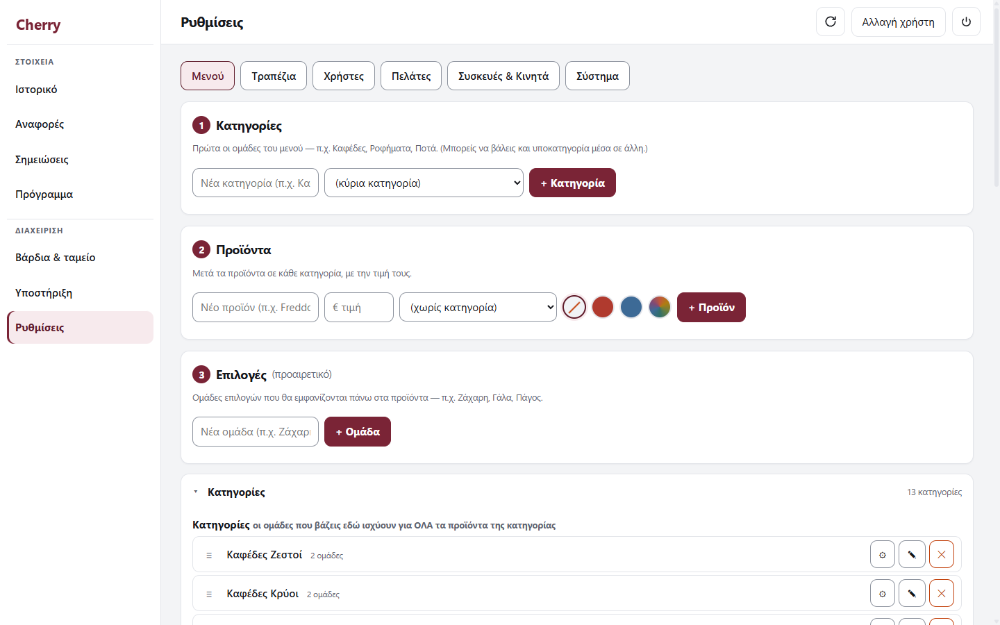
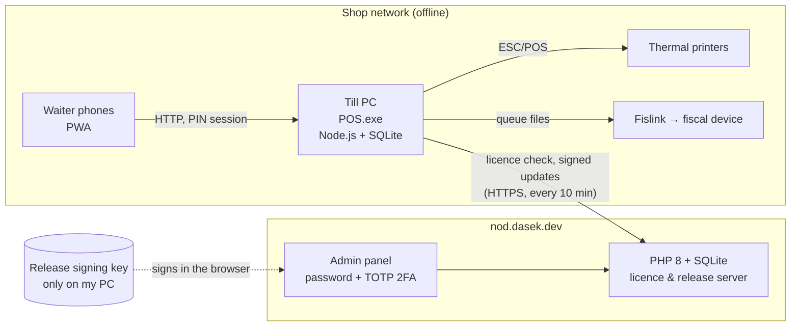

# Nōd: offline POS for cafés & bars

> **Showcase only.** The source code is private. This page describes what Nōd does,
> how it is built and, mostly, how it is secured.

Nōd is a point-of-sale system I built for a real café-bar in Greece and now license
to other shops. Waiters take orders on their phones over the shop Wi-Fi; the till PC
prints kitchen/bar slips and fiscal receipts; the manager sees shifts and reports.
It runs **fully offline**. The internet is only used for licences and updates.

| Order screen (till) | Reports |
|---|---|
|  |  |
| **Tables** | **Settings** |
|  |  |

## What it does

- **Tables & orders** from any phone on the shop Wi-Fi (PWA, PIN login per employee)
- **Kitchen / bar slips** on thermal printers (raw ESC/POS over the network)
- **Fiscal receipts** through the Greek fiscal device bridge (Fislink)
- **Item-level cancellations**, split payments, discounts, all attributed per employee
- **Shifts & cash-up**: declared vs. counted cash, per-shift and per-day reports
- **Work schedule**, notes, menu editor with drag-to-reorder and per-category options
- **Annual licences and signed auto-updates** through a small cloud panel

## Architecture

- **Zero dependencies.** The till server uses only Node.js built-ins (`node:http`,
  `node:sqlite`, `node:crypto`, `node:zlib`). No `npm install`, no supply chain to trust.
- **One file.** Packaged as a single `POS.exe` (Node Single Executable Application).
- **Data outside the program folder** (`%ProgramData%`), so replacing the program never
  touches sales data.

## Security work

### Signed releases & self-update with rollback
- Every release is signed with **Ed25519**. The private key never leaves my PC: the admin
  panel signs **in the browser** (WebCrypto) and uploads only the signature. The server
  checks it, and **every till checks it again** before installing, so a compromised server
  alone cannot push code to shops.
- Updates install by themselves outside opening hours, or immediately from the panel.
- The till replaces its own executable and **rolls back automatically** if the new version
  does not come up healthy. Tested with a deliberately broken release.
- The first real test caught a hang in the original script-based restart; it was replaced
  by an in-process swap and re-verified end-to-end through the live panel.

### Licensing
- Licences are **Ed25519-signed tokens** bound to one machine; the signing key exists only
  on the server.
- Activation codes, revoke / move-to-new-PC / renew from the panel.

### Login security on the shop network
An internal audit of the till's login led to four fixes:
- no shared or hard-coded vendor credentials; support access is granted by the shop itself,
  for a limited time
- rate limiting and lockouts on password and PIN login
- weak or default credentials are flagged and restricted
- sensitive roles are limited to the till itself

### Cloud panel
- Password + **TOTP 2FA**, CSRF protection, CSP, HSTS, login throttling.
- Found and fixed a **hosting cache leak**: the host's page cache ignored `no-store` and
  could briefly serve a logged-in page to an anonymous visitor.
- **Encrypted nightly backups**; only an offline key can open them, and restores are tested.

## Stack

Node.js (zero dependencies) · JavaScript (no framework) · SQLite · ESC/POS ·
Node SEA · PHP 8 · Ed25519 / WebCrypto · TOTP · HTML/CSS

---

Built by **Filippos Ntasek** · [dasek.dev](https://dasek.dev) · in daily use at a café-bar in Greece.

© 2026 Filippos Ntasek. All rights reserved. The source code is private and Nōd is available under licence.
